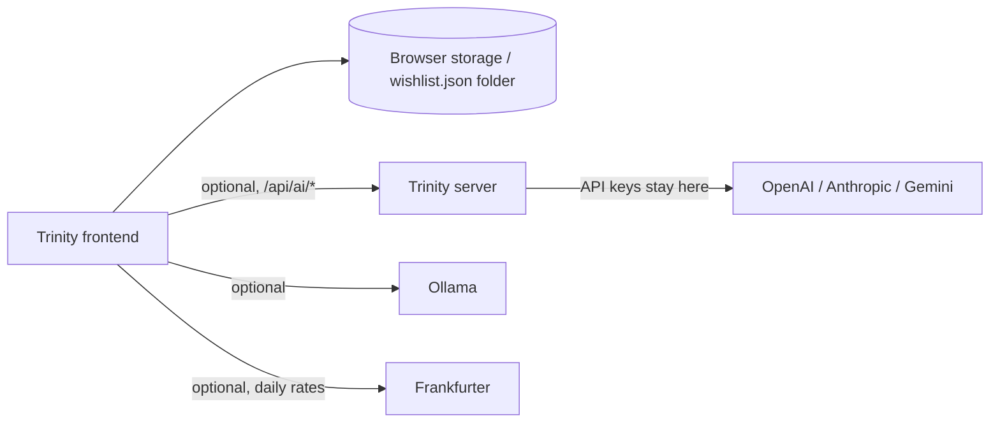

<pre>
 _________________      _____    ____  _____   ______    ____  _________________  _____      _____
/                 \ ___|\    \  |    ||\    \ |\     \  |    |/                 \|\    \    /    /|
\______     ______/|    |\    \ |    | \\    \| \     \ |    |\______     ______/| \    \  /    / |
   \( /    /  )/   |    | |    ||    |  \|    \  \     ||    |   \( /    /  )/   |  \____\/    /  /
    ' |   |   '    |    |/____/ |    |   |     \  |    ||    |    ' |   |   '     \ |    /    /  /
      |   |        |    |\    \ |    |   |      \ |    ||    |      |   |          \|___/    /  /
     /   //        |    | |    ||    |   |    |\ \|    ||    |     /   //              /    /  /
    /___//         |____| |____||____|   |____||\_____/||____|    /___//              /____/  /
   |`   |          |    | |    ||    |   |    |/ \|   |||    |   |`   |              |`    | /
   |____|          |____| |____||____|   |____|   |___|/|____|   |____|              |_____|/
     \(              \(     )/    \(       \(       )/    \(       \(                   )/
      '               '     '      '        '       '      '        '                   '
</pre>

> **A personal, local-first wishlist that runs entirely in your browser.**

[](https://opensource.org/licenses/MIT)
[](https://nodejs.org/)
[](https://www.typescriptlang.org/)
[](https://vitejs.dev/)
[]()

Organize ideas into nested collections, track prices in EUR, import Markdown or CSV files, and plan your purchases, all without an account, cloud database, or internet connection. Your data stays on your device.

> 🇳🇱 Lees dit in het Nederlands: [Nederlandstalige README](README.nl.md).

---

## 📖 Table of Contents

- [What is Trinity?](#-what-is-Trinity)
- [Features](#-features)
  - [Core](#core)
  - [Organization](#organization)
  - [Import & Export](#import--export)
  - [AI Assistance](#-ai-assistance)
  - [Planning & Tracking](#-planning--tracking)
  - [Interface](#-interface)
  - [Data & Privacy](#-data--privacy)
- [Quick Start](#-quick-start)
- [Keyboard Shortcuts](#-keyboard-shortcuts)
- [Tech Stack & Architecture](#-tech-stack--architecture)
- [Configuration](#-configuration)
- [AI-Assisted Import](#-ai-assisted-import)
- [Server-Side Saving (NAS / SMB)](#-server-side-saving-nas--smb)
- [Data & Backups](#-data--backups)
- [Deployment](#-deployment)
  - [Docker / Proxmox](#docker--proxmox)
  - [Desktop App](#-desktop-app)
- [Development](#-development)
- [Security](#-security)
- [Accessibility](#-accessibility)
- [Troubleshooting](#-troubleshooting)
- [Project Structure](#-project-structure)
- [AI-Assisted Development](#-ai-assisted-development)

---

## 🎯 What is Trinity?

Trinity is a **wishlist that runs entirely in your browser**. There's no account to create, no cloud database, and no subscription. Your wishlist lives in your browser's storage or in a `wishlist.json` file in a folder you choose, fully portable, fully yours.

An optional lightweight server adds AI-assisted Markdown import (via OpenAI, Anthropic, Google Gemini, or local Ollama), but the core app works completely offline without any backend.

**Why Trinity?**

| Traditional wishlists | Trinity |
|---|---|
| Require an account | No account needed |
| Store data on their servers | Your data stays on your device |
| Limited organization | Nested groups, tags, priorities, statuses |
| No offline access | Works 100% offline |
| One-size-fits-all | Import from Markdown, CSV, or AI-assisted |
| No budget tracking | Built-in budget and goal tracking |

## ✨ Features

### Core

- **EUR price tracking**: Estimate prices per item with group and total summaries, plus optional daily reference rates from [Frankfurter](https://www.frankfurter.dev/)
- **Full-text search**: Search across item names, brands, tags, links, notes, and purchase sources
- **Fuzzy search**: Find items even with typos; results ranked by match quality
- **Sort options**: Sort by recently added, date added, name (A-Z), lowest/highest price, priority, or status
- **Side-by-side comparison**: Compare selected items in a detailed table view

### Organization

- **Nested collections**: Organize items into groups and subgroups with unlimited nesting
- **Group collapse/expand**: Collapse nested groups in the sidebar to reduce clutter
- **Tags**: Add comma-separated tags to items for cross-cutting organization
- **Tag filtering**: One-click tag chips showing item counts for instant filtering
- **Priority levels**: Mark items as High, Medium, or Low priority
- **Status workflow**: Track items through Wanted → Researching → Planned → Purchased
- **Status filtering**: Filter by status with dedicated sub-filters
- **Item dependencies**: Mark items as "blocked by" another item or condition
- **Drag & drop**: Reorder items, move between groups, and nest groups via drag-and-drop (works on touch devices)

### Import & Export

- **Markdown import**: Import `.md` and `.markdown` files with headings, lists, and tables
- **CSV import**: Import CSV files with wishlist columns
- **AI-assisted import**: Use OpenAI, Anthropic, Google Gemini, or local Ollama to organize messy Markdown
- **CSV export**: Export your wishlist as a CSV file for spreadsheets
- **Markdown export**: Export your wishlist as a formatted Markdown file
- **JSON export/restore**: Download and restore your wishlist as JSON
- **ZIP backup**: Create portable ZIP backups of your entire wishlist
- **PDF export**: Export a printable PDF using the browser's print function

### 🤖 AI Assistance

- **Multi-provider support**: Choose from OpenAI, Anthropic, Google Gemini, or local Ollama
- **Markdown organization**: AI refines messy Markdown into structured wishlist items
- **Privacy-first**: Only the Markdown you choose to improve is sent; CSV files are never sent
- **Local AI**: Use Ollama for completely private, offline AI processing

### 📊 Planning & Tracking

- **Budget tracking**: Set a monthly budget and monitor spending with a visual progress bar
- **Wishlist goals**: Set a target number of items to purchase with an optional deadline
- **Price alerts**: Set a target price per item; get a "🔔 Deal!" badge when the price drops
- **Price history**: Track price changes over time with sparkline charts on item cards
- **Price timeline view**: Click any sparkline to see a detailed price history chart with statistics
- **Purchase history**: Record when and where you bought each item
- **Item notes journal**: Append dated notes to items over time for research and decisions
- **Statistics dashboard**: View SVG charts showing spending by group and items by status

### 🎨 Interface

- **Light & dark themes**: Applied before first paint; no flash for dark-mode users
- **Dark mode schedule**: Auto-switch themes based on time of day or system preference
- **Item images**: Attach product image URLs displayed as thumbnails on item cards
- **Shopping list mode**: Compact checklist view of purchased items, optimized for in-store use
- **Wishlist sharing**: Generate a shareable link or download JSON for gift guides
- **PWA support**: Install as a standalone app with offline access
- **Keyboard navigation**: Full keyboard support with focus trapping in dialogs
- **Bundled fonts**: DM Sans and Manrope via Fontsource; no external CDN calls
- **Bulk actions**: Multi-select items to change status, move, or remove in one step
- **Item duplication**: One-click duplicate any item from the item menu
- **Item favorites**: Star items for quick access with a dedicated favorites filter
- **Group color coding**: Assign colors to groups for visual distinction in the sidebar

### 🔒 Data & Privacy

- **Local-first**: Your data never leaves your device unless you choose to
- **Folder autosave**: Autosave to `wishlist.json` in a folder you choose
- **No account required**: No sign-up, no cloud database, no tracking
- **Server-side saving**: Optional NAS/SMB save for central backup
- **Reduced motion support**: Respects system accessibility preferences

---

## 🚀 Quick Start

Get Trinity running in under a minute:

```sh
# Clone and install
git clone https://github.com/LukaG712/Trinity.git
cd Trinity/frontend
npm ci
npm run dev
```

Open the local URL printed by Vite (usually `http://127.0.0.1:5173`). That's it, Trinity works without any backend.

**Want AI-assisted import?** Start the optional server in a second terminal:

```sh
node server/index.mjs
```

**Want a desktop app?** See the [Desktop App](#-desktop-app) section below.

**Want to deploy on your home network?** See the [Docker / Proxmox](#docker--proxmox) section.

---

## ⌨️ Keyboard shortcuts

| Shortcut | Action |
| --- | --- |
| `Ctrl/Cmd + K` | Focus the search field |
| `Ctrl/Cmd + I` | Open the add-item form |
| `Esc` | Close a dialog (focus is restored) |

> 💡 Shortcut hints appear when you hover or focus the search field and the quick-add button.

---

## 🏗️ Tech stack and architecture

| Component | Technology |
| --- | --- |
| Frontend | Vite (in `frontend/`) |
| Optional server | Node.js (`server/index.mjs`) |
| Storage | Browser storage, optionally an autosaved `wishlist.json` in a folder you choose |
| Cloud AI (optional) | OpenAI, Anthropic, Google Gemini via the Trinity server |
| Local AI (optional) | Ollama HTTP API, called from the browser |
| Exchange rates (optional) | Frankfurter reference rates |
| Server tests | `npm test` in `server/` (6 passing) |
| Frontend tests | `npm test` in `frontend/` (27 passing) |
| Deployment | Docker image / Docker Compose |



The server serves the production frontend build (`frontend/dist`, same origin) and exposes `/api/health` plus the `/api/ai/*` endpoints. It has no wishlist database.

---

## 📦 Installation

### Requirements

- **Required:** Node.js 22 or newer
- **Optional:** API key(s) for OpenAI, Anthropic, or Google Gemini (for cloud AI import)
- **Optional:** [Ollama](https://ollama.com/download) (for local AI import)
- **Optional:** Docker (for private deployment)

### Step 1: Start the frontend

```sh
cd frontend
npm ci
npm run dev
```

Open the local URL printed by Vite (usually `http://127.0.0.1:5173`). The core wishlist works without any backend.

### Step 2: Start the optional server (AI import)

For cloud AI import assistance, open a second terminal:

```sh
node server/index.mjs
```

Or run `npm start` from `server/`. Configure provider keys as described under [Configuration](#-configuration).

### Step 3: Build for production

```sh
cd frontend
npm run build
```

This produces `frontend/dist`, which the server serves on the same origin. The Docker image builds it automatically.

---

## 🤖 AI-Assisted Import

Trinity imports `.md`, `.markdown`, and `.csv` files locally. The deterministic parser detects headings, list entries, Markdown tables, and wishlist CSV columns. Review the results and select what to import.

### How AI assistance works

For optional AI-assisted Markdown organization, connect one of:

| Provider | How it connects | Privacy |
|---|---|---|
| **OpenAI** | Through the Trinity server | API key stays on server |
| **Anthropic** | Through the Trinity server | API key stays on server |
| **Google Gemini** | Through the Trinity server | API key stays on server |
| **Ollama (local)** | Directly from your browser | Fully offline, no API key |

> 🔒 **Privacy-first:** AI assistance only refines Markdown import results. Only the Markdown you explicitly choose to **Improve** is sent. CSV files are never sent for AI processing, and nothing is imported until you confirm.

### Import details

- Explicit EUR prices are used in totals
- Non-EUR or uncertain amounts remain marked as unverified and are excluded
- Prices entered in the app are stored as EUR estimates
- Optional daily reference rates from [Frankfurter](https://www.frankfurter.dev/) convert display totals and item prices

---

## ⚙️ Configuration

The server reads its provider keys from its private environment. Copy `.env.example` to `.env` in the project root, keep the file private, and add a key only for a provider you intend to use:

```sh
cp .env.example .env
nano .env  # Add your API keys
chmod 600 .env  # Restrict access
```

### Environment variables

| Variable | Default | Purpose |
| --- | --- | --- |
| `PORT` | `3000` | Server port |
| `HOST` | `0.0.0.0` | Server bind address |
| `OPENAI_API_KEY` | None | Enables OpenAI models for import assistance |
| `ANTHROPIC_API_KEY` | None | Enables Anthropic models for import assistance |
| `GEMINI_API_KEY` | None | Enables Google Gemini models for import assistance |
| `Trinity_SAVE_DIR` | None | Server-side wishlist saving directory (e.g., mounted NAS/SMB) |

### Setting up AI in the app

After configuring `.env`, in Trinity open **Preferences → Cloud AI models**, refresh models, choose a provider and model, and select **Use for imports**.

> ⚠️ **Security:** The frontend never receives API keys. Never paste credentials into chat or browser settings.

### Theme

The theme is remembered in `wishr-theme` (or follows the operating system when nothing is saved). Use the sun/moon button in the header or **Preferences → Appearance** to switch.

---

## 💾 Server-Side Saving (NAS / SMB)

Trinity can optionally save your wishlist to a directory on the server instead of (or in addition to) browser storage. This is useful for keeping a central copy on a NAS or SMB share.

### Setup

1. Mount your NAS or SMB share on the server at a path such as `/mnt/nas/Trinity`
2. Add `Trinity_SAVE_DIR=/mnt/nas/Trinity` to the server's `.env` file
3. Restart the server: `docker compose up -d --build`
4. Open **Settings → Save to server (NAS / SMB)** and click **Save to server**

The server writes `wishlist.json` to the configured directory. The wishlist file itself never leaves your server.

---

## 📁 Data & Backups

Trinity stores its working copy in browser storage. Here's how to keep your data safe:

### Folder autosave

In supported browsers (Chrome, Edge), use **Preferences → Choose folder** to autosave a `wishlist.json` file. Requires localhost or HTTPS with your permission. If permission expires, simply reconnect the folder.

### Manual backup

On browsers without direct folder writing, download JSON after editing and save it yourself.

### Backup options

| Method | Use case |
|---|---|
| **Folder autosave** | Automatic backup to a local folder |
| **JSON download** | Manual backup after editing |
| **ZIP backup** | Portable snapshot of your entire wishlist |
| **Restore JSON** | Merge a valid backup into your current list |
| **Server save** | Central backup on NAS/SMB |

> 💡 Choosing a folder that already contains a wishlist merges unique groups and items, matching items are never duplicated. A malformed file is reported and never overwritten.

---

## 🚀 Deployment

### Docker / Proxmox

The included Docker setup is intended for a **private home-network/VPN deployment**. The server has **no user authentication**, do not expose port 3000 to the public internet.

> ⚠️ **Security warning:** Never add a router port-forward or publish Trinity on an untrusted network.

#### Step 1: Create the VM

In Proxmox, create an Ubuntu Server 24.04 LTS VM attached to your trusted LAN bridge (commonly `vmbr0`):

| Resource | Recommended |
|---|---|
| vCPUs | 2 |
| RAM | 2 GB |
| Disk | 16 GB |

Give the VM a DHCP reservation in your router so its LAN address remains stable. Install Docker Engine following the official [Docker Ubuntu instructions](https://docs.docker.com/engine/install/ubuntu/).

#### Step 2: Copy and configure Trinity

```sh
# Copy project to VM via scp, then:
cp .env.example .env
nano .env  # Add only the API keys you use
chmod 600 .env  # Restrict access
```

Build and start:

```sh
docker compose up -d --build
docker compose logs -f Trinity
```

Visit `http://<VM-LAN-IP>:3000` from a device on your trusted network.

#### Step 3: Restrict network access

```sh
sudo ufw default deny incoming
sudo ufw allow from <HOME-LAN-CIDR> to any port 3000 proto tcp
sudo ufw allow from <VPN-CIDR> to any port 3000 proto tcp
sudo ufw enable
```

> 🔒 **Important:** Docker may bypass UFW rules. Enforce source-network restrictions in the Proxmox firewall or another firewall layer, and verify access from both allowed and disallowed networks.

#### Updating

```sh
docker compose up -d --build
```

Keep `.env` backed up privately. To stop: `docker compose down`.

---

### 🖥️ Desktop App

A standalone Windows desktop app is available, no browser tabs, no installation required.

| File | Description |
|---|---|
| `Desktop/release/Trinity-Portable.exe` | Single portable executable, double-click and run |

The desktop app bundles the frontend and Node.js server together, opening Trinity in its own native window. Your data stays in browser storage or a folder you choose, exactly like the web version.

#### Building the desktop app

```sh
# Build the frontend first
cd frontend && npm ci && npm run build

# Build the portable desktop app
cd ../Desktop && npm ci && npm run build
```

The portable executable will be at `Desktop/release/Trinity-Portable.exe`.

## 🛠️ Development

### Running tests

```sh
# Frontend tests (27 passing)
cd frontend && npm test

# Server tests (6 passing)
cd server && npm test
```

**Total: 33 passing tests**

### Building

```sh
cd frontend
npm ci
npm run build
```

### Project structure

```text
Trinity/
├── frontend/       Vite application (wishlist UI, import parser, backups)
│   ├── src/        TypeScript/React source files
│   ├── index.html  Entry point
│   └── package.json
├── server/         Optional Node.js server
│   ├── index.mjs   Server entry point
│   └── index.test.mjs  Server tests
├── Desktop/        Electron wrapper for portable .exe
├── Dockerfile      Docker image definition
├── docker-compose.yml  Docker Compose configuration
├── manifest.json   PWA manifest
├── sw.js           Service worker for offline support
├── README.md       This file
└── README.nl.md    Dutch translation
```

---

## 🔒 Security

- **No authentication**: The server has no user login. Keep it on a private network or behind a VPN.
- **Never expose port 3000** to the public internet.
- **API keys** live only in the server's `.env` file (kept out of source control, `chmod 600`). The browser never receives them.
- **Your data stays local**: Your wishlist lives in your browser or a folder you choose. The server has no wishlist database.
- **AI privacy**: Only the Markdown you explicitly choose to **Improve** is sent to the selected model. CSV files are never sent.
- **Ollama**: Set only to an endpoint you trust.
- **Cloud costs**: Cloud model usage may incur charges from the provider.
- **Always review** AI output before importing.

---

## ♿ Accessibility

- **Keyboard navigation**: Full keyboard support with visible focus indicators
- **Dialog focus trapping**: Focus stays within open dialogs
- **Escape to close**: Press `Esc` to close any dialog (focus is restored)
- **Reduced motion**: Respects the system's `prefers-reduced-motion` preference
- **Light & dark themes**: Two complete themes with proper contrast ratios
- **Custom favicon**: Built-in Trinity favicon (dark tile with a green dot)

---

## 🐛 Troubleshooting

### Folder autosave doesn't work

- **Cause:** Folder autosave requires a secure context (localhost or HTTPS). Plain HTTP on a LAN address may not work.
- **Solution:** Use JSON download/restore for backups, or set up HTTPS with a trusted certificate.

### AI import doesn't work

- **Cause:** Missing or invalid API key in `.env`.
- **Solution:** Verify your API key is correct and the server is running. Check `docker compose logs Trinity` for errors.

### Docker port conflicts

- **Cause:** Port 3000 is already in use.
- **Solution:** Change the port in `.env`: `PORT=3001`, then rebuild with `docker compose up -d --build`.

### Wishlist not saving

- **Cause:** Browser storage is full or folder permission expired.
- **Solution:** Use **Settings → Choose folder** to reconnect, or download a JSON backup.

### Dark mode flash on load

- **Cause:** Theme is applied before first paint, but some browsers may still flash.
- **Solution:** This is a browser limitation. The theme is set as early as possible to minimize the flash.

---

## 🤖 AI-Assisted Development

This project was developed with extensive use of **AI development tools** including ChatGPT and OpenAI Codex.

The human developer was responsible for:

- Defining requirements and desired functionality
- Making architectural and technical decisions
- Directing implementation through iterative prompts
- Testing the application and integrations
- Reviewing and correcting generated code
- Debugging issues during development
- Setting up the Git/GitHub workflow and documentation
