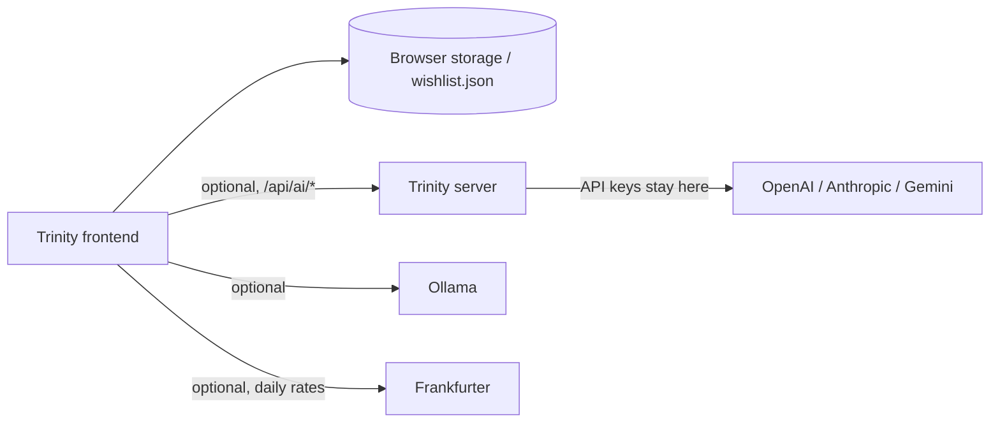

# Trinity \u2013 Your Personal Wishlist

> A private, local-first wishlist that runs entirely in your browser. No account, no cloud, no subscription.

[](https://opensource.org/licenses/MIT)
[](https://nodejs.org/)
[](https://www.typescriptlang.org/)
[](https://vitejs.dev/)

Organize ideas into collections, track prices, plan purchases, and share your wishlist \u2013 all without an account or internet connection. Your data stays on your device.

---

## 🎯 What is Trinity?

Trinity is a **wishlist that runs entirely in your browser**. There's no account to create, no cloud database, and no subscription. Your wishlist lives in your browser's storage or in a `wishlist.json` file in a folder you choose \u2013 fully portable, fully yours.

An optional lightweight server adds AI-assisted Markdown import (via OpenAI, Anthropic, Google Gemini, or local Ollama), but the core app works **completely offline** without any backend.

### Why Trinity?

| Traditional wishlists | Trinity |
|---|---|
| Require an account | **No account needed** |
| Store data on their servers | **Your data stays on your device** |
| Limited organization | **Nested groups, tags, priorities, statuses** |
| No offline access | **Works 100% offline** |
| One-size-fits-all | **Import from Markdown, CSV, or AI-assisted** |
| No budget tracking | **Built-in budget and goal tracking** |

---

## 🚀 Get started in under a minute

```sh
git clone https://github.com/LukaG712/Trinity.git
cd Trinity/frontend
npm ci
npm run dev
```

Open the URL Vite prints (usually `http://127.0.0.1:5173`). **That's it** \u2013 Trinity works without any backend.

**Want AI-assisted import?** Start the optional server:
```sh
node server/index.mjs
```

**Want a desktop app?** See the [Desktop App](#-desktop-app) section.

**Want to deploy on your home network?** See the [Docker / Proxmox](#docker--proxmox) section.

---

## ✨ Features

### 💰 Price Tracking

- **EUR price tracking** \u2013 estimate prices per item with group and total summaries
- **Currency conversion** \u2013 optional daily reference rates from [Frankfurter](https://www.frankfurter.dev/)
- **Price history** \u2013 track price changes over time with sparkline charts on item cards
- **Price timeline** \u2013 click any sparkline to see a detailed price history chart with statistics
- **Price alerts** \u2013 set a target price per item; get a "🔔 Deal!" badge when the price drops

### 📊 Planning & Budgeting

- **Budget tracking** \u2013 set a monthly budget and monitor spending with a visual progress bar
- **Wishlist goals** \u2013 set a target number of items to purchase with an optional deadline
- **Statistics dashboard** \u2013 view SVG charts showing spending by group and items by status
- **Purchase history** \u2013 record when and where you bought each item

### 📂 Organization

- **Nested collections** \u2013 organize items into groups and subgroups with unlimited nesting
- **Group collapse/expand** \u2013 reduce clutter by collapsing nested groups
- **Tags** \u2013 add comma-separated tags for cross-cutting organization
- **Tag filtering** \u2013 one-click tag chips showing item counts for instant filtering
- **Priority levels** \u2013 mark items as High, Medium, or Low priority
- **Status workflow** \u2013 track items through Wanted → Researching → Planned → Purchased
- **Item dependencies** \u2013 mark items as "blocked by" another item or condition
- **Drag & drop** \u2013 reorder items, move between groups, and nest groups (works on touch devices)
- **Item favorites** \u2013 star items for quick access with a dedicated favorites filter
- **Group color coding** \u2013 assign colors to groups for visual distinction

### 🔍 Search & Compare

- **Full-text search** \u2013 search across names, brands, tags, links, notes, and sources
- **Fuzzy search** \u2013 find items even with typos; results ranked by match quality
- **Sort options** \u2013 sort by date, name, price, priority, or status
- **Side-by-side comparison** \u2013 compare selected items in a detailed table view
- **Bulk actions** \u2013 multi-select items to change status, move, or remove in one step

### 📥 Import & Export

- **Markdown import** \u2013 import `.md` files with headings, lists, and tables
- **CSV import** \u2013 import CSV files with wishlist columns
- **AI-assisted import** \u2013 use AI to organize messy Markdown
- **Export** \u2013 CSV, Markdown, JSON, ZIP backup, and PDF (via browser print)

### 🔗 Sharing

- **Share links** \u2013 generate a shareable link so others can view your wishlist (great for gift guides!)
- **Read-only shared view** \u2013 recipients see your wishlist without edit controls

### 🤖 AI Assistance

- **Multi-provider support** \u2013 OpenAI, Anthropic, Google Gemini, or local Ollama
- **Markdown organization** \u2013 AI refines messy Markdown into structured items
- **Privacy-first** \u2013 only the Markdown you choose to improve is sent; CSV files are never sent
- **Local AI** \u2013 use Ollama for completely private, offline AI processing

### 🎨 Interface

- **Light & dark themes** \u2013 applied before first paint; no flash for dark-mode users
- **Dark mode schedule** \u2013 auto-switch themes based on time of day or system preference
- **Item images** \u2013 attach product image URLs displayed as thumbnails
- **Shopping list mode** \u2013 compact checklist view of purchased items, optimized for in-store use
- **PWA support** \u2013 install as a standalone app with offline access
- **Keyboard navigation** \u2013 full keyboard support with focus trapping in dialogs
- **Bundled fonts** \u2013 DM Sans and Manrope via Fontsource; no external CDN calls

### 🔒 Data & Privacy

- **Local-first** \u2013 your data never leaves your device unless you choose to
- **Folder autosave** \u2013 autosave to `wishlist.json` in a folder you choose
- **No account required** \u2013 no sign-up, no cloud database, no tracking
- **Server-side saving** \u2013 optional NAS/SMB save for central backup
- **Reduced motion support** \u2013 respects system accessibility preferences

---

## ⌨️ Keyboard Shortcuts

| Shortcut | Action |
|---|---|
| `Ctrl/Cmd + K` | Focus the search field |
| `Ctrl/Cmd + I` | Open the add-item form |
| `Esc` | Close a dialog (focus is restored) |

> 💡 Shortcut hints appear when you hover or focus the search field and the quick-add button.

---

## ⚙️ Configuration

The server reads its provider keys from its private environment. Copy `.env.example` to `.env`:

```sh
cp .env.example .env
nano .env  # Add your API keys
chmod 600 .env  # Restrict access
```

### Environment Variables

| Variable | Default | Purpose |
|---|---|---|
| `PORT` | `3000` | Server port |
| `HOST` | `0.0.0.0` | Server bind address |
| `OPENAI_API_KEY` | None | Enables OpenAI models for import |
| `ANTHROPIC_API_KEY` | None | Enables Anthropic models for import |
| `GEMINI_API_KEY` | None | Enables Google Gemini models for import |
| `Trinity_SAVE_DIR` | None | Server-side wishlist saving directory |

### Setting up AI in the app

After configuring `.env`, open **Preferences → Cloud AI models**, refresh models, choose a provider and model, and select **Use for imports**.

> ⚠️ **Security:** The frontend never receives API keys. Never paste credentials into chat or browser settings.

---

## 🏗️ Tech Stack

| Component | Technology |
|---|---|
| Frontend | Vite, React, TypeScript |
| Optional server | Node.js (`server/index.mjs`) |
| Storage | Browser storage + optional `wishlist.json` |
| Cloud AI (optional) | OpenAI, Anthropic, Google Gemini |
| Local AI (optional) | Ollama HTTP API |
| Exchange rates | Frankfurter reference rates |
| Deployment | Docker / Docker Compose |



---

## 🤖 AI-Assisted Import

Trinity imports `.md`, `.markdown`, and `.csv` files locally. The parser detects headings, list entries, Markdown tables, and CSV columns.

### How AI assistance works

| Provider | How it connects | Privacy |
|---|---|---|
| **OpenAI** | Through the Trinity server | API key stays on server |
| **Anthropic** | Through the Trinity server | API key stays on server |
| **Google Gemini** | Through the Trinity server | API key stays on server |
| **Ollama (local)** | Directly from your browser | Fully offline, no API key |

> 🔒 **Privacy-first:** Only the Markdown you explicitly choose to **Improve** is sent. CSV files are never sent for AI processing.

---

## 💾 Data & Backups

Trinity stores its working copy in browser storage. Here's how to keep your data safe:

### Backup Options

| Method | Use case |
|---|---|
| **Folder autosave** | Automatic backup to a local folder (Chrome, Edge) |
| **JSON download** | Manual backup after editing |
| **ZIP backup** | Portable snapshot of your entire wishlist |
| **Restore JSON** | Merge a valid backup into your current list |
| **Server save** | Central backup on NAS/SMB |

> 💡 Choosing a folder that already contains a wishlist merges unique groups and items \u2013 matches are never duplicated.

### Server-Side Saving (NAS / SMB)

1. Mount your NAS or SMB share on the server (e.g., `/mnt/nas/Trinity`)
2. Add `Trinity_SAVE_DIR=/mnt/nas/Trinity` to `.env`
3. Restart the server
4. Open **Settings → Save to server** and click **Save to server**

---

## 🚀 Deployment

### Docker / Proxmox

> ⚠️ **Security warning:** The server has **no user authentication**. Keep it on a private network \u2013 never expose port 3000 to the public internet.

#### Quick Start

```sh
# Copy project to your server, then:
cp .env.example .env
nano .env  # Add only the API keys you use
chmod 600 .env

docker compose up -d --build
docker compose logs -f Trinity
```

Visit `http://<server-ip>:3000` from a device on your trusted network.

#### Proxmox VM Specs

| Resource | Recommended |
|---|---|
| vCPUs | 2 |
| RAM | 2 GB |
| Disk | 16 GB |

#### Restrict Network Access

```sh
sudo ufw default deny incoming
sudo ufw allow from <HOME-LAN-CIDR> to any port 3000 proto tcp
sudo ufw enable
```

> 🔒 **Important:** Docker may bypass UFW rules. Enforce source-network restrictions in the Proxmox firewall.

#### Updating

```sh
docker compose up -d --build
```

### 🖥️ Desktop App

A standalone Windows desktop app \u2013 no browser tabs, no installation required.

| File | Description |
|---|---|
| `Desktop/release/Trinity-Portable.exe` | Single portable executable, double-click and run |

#### Building the desktop app

```sh
cd frontend && npm ci && npm run build
cd ../Desktop && npm ci && npm run build
```

Output: `Desktop/release/Trinity-Portable.exe`.

---

## 🛠️ Development

### Running tests

```sh
# Frontend tests (27 passing)
cd frontend && npm test

# Server tests (6 passing)
cd server && npm test
```

**Total: 33 passing tests**

### Building

```sh
cd frontend
npm ci
npm run build
```

---

## 📁 Project Structure

```
Trinity/
├── frontend/          # Vite application (wishlist UI, import parser, backups)
│   ├── src/           # TypeScript/React source files
│   │   ├── components/ # UI components (Sidebar, ItemList, etc.)
│   │   ├── App.tsx     # Main application
│   │   ├── domain.ts   # Types and validation
│   │   └── share.ts    # Share link encoding/decoding
│   └── index.html      # Entry point
├── server/            # Optional Node.js server for AI import
│   ├── index.mjs       # Server entry point
│   └── index.test.mjs  # Server tests
├── Desktop/           # Electron wrapper for portable .exe
├── Dockerfile         # Docker image definition
├── docker-compose.yml # Docker Compose configuration
├── manifest.json      # PWA manifest
└── sw.js              # Service worker for offline support
```

---

## 🔒 Security

- **No authentication** \u2013 keep the server on a private network or behind a VPN
- **Never expose port 3000** to the public internet
- **API keys** live only in `.env` (kept out of source control, `chmod 600`)
- **Your data stays local** \u2013 wishlist lives in your browser or a folder you choose
- **AI privacy** \u2013 only Markdown you choose to Improve is sent; CSV files are never sent
- **Cloud costs** \u2013 cloud model usage may incur charges from the provider

---

## ♿ Accessibility

- **Keyboard navigation** \u2013 full keyboard support with visible focus indicators
- **Dialog focus trapping** \u2013 focus stays within open dialogs
- **Escape to close** \u2013 press `Esc` to close any dialog
- **Reduced motion** \u2013 respects `prefers-reduced-motion` system preference
- **Light & dark themes** \u2013 two complete themes with proper contrast ratios

---

## 🐛 Troubleshooting

### Folder autosave doesn't work
- **Cause:** Requires a secure context (localhost or HTTPS). Plain HTTP on a LAN address may not work.
- **Solution:** Use JSON download/restore for backups, or set up HTTPS.

### AI import doesn't work
- **Cause:** Missing or invalid API key in `.env`.
- **Solution:** Verify your API key and check `docker compose logs Trinity`.

### Docker port conflicts
- **Cause:** Port 3000 is already in use.
- **Solution:** Change port in `.env`: `PORT=3001`, then rebuild.

### Wishlist not saving
- **Cause:** Browser storage is full or folder permission expired.
- **Solution:** Use **Settings → Choose folder** to reconnect, or download a JSON backup.

---

## 🤝 Contributing

Contributions are welcome! Please feel free to submit a Pull Request.

---

## 📜 License

MIT License \u2013 see [LICENSE](LICENSE) for details.

---

## 🤖 AI-Assisted Development

This project was developed with extensive use of AI development tools (ChatGPT, OpenAI Codex). The human developer defined requirements, made architectural decisions, directed implementation, tested, reviewed, and debugged the application.
