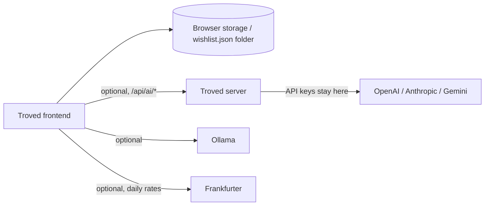

# Troved

A personal, local-first wishlist with a quiet GitHub-inspired interface and a restrained green accent. Organize ideas into nested collections, keep EUR estimates, search and filter your list, and import Markdown or CSV files.

> Lees dit in het Nederlands: [Nederlandstalige README](README.nl.md).

## What is this?

Troved is a wishlist that runs in your browser. Your wishlist stays in your browser storage or in a folder you choose; there is no Troved account or wishlist database. An optional small server adds AI-assisted Markdown import through OpenAI, Anthropic, Google Gemini, or a local Ollama instance, but the core app works without it.

## Features

- Nested collections for organizing wishlist items
- EUR estimates per item, with totals and optional daily reference rates from [Frankfurter](https://www.frankfurter.dev/)
- Search and filter across your whole list
- Local import of `.md`, `.markdown`, and `.csv` files (headings, list entries, Markdown tables, and wishlist CSV columns), with review before anything is imported
- Optional AI-assisted Markdown organization (OpenAI, Anthropic, Google Gemini, or Ollama)
- Folder autosave to a `wishlist.json` file, JSON download/restore, and ZIP backup
- Light and dark themes, applied before first paint so dark-mode users see no light flash
- Fonts bundled via Fontsource (DM Sans, Manrope); no webfont CDN is contacted
- Keyboard navigation, dialog focus trapping, and reduced-motion support
- Tags and priority rating per item for cross-cutting organization

## Keyboard shortcuts

| Shortcut | Action |
| --- | --- |
| `Ctrl/Cmd + K` | Focus wishlist search |
| `Ctrl/Cmd + I` | Open the add-item form |
| `Esc` | Close a dialog (focus is restored afterwards) |

Shortcut hints appear when you hover or focus the search field and the quick-add button.

## Tech stack and architecture

| Component | Technology |
| --- | --- |
| Frontend | Vite (in `frontend/`) |
| Optional server | Node.js (`server/index.mjs`) |
| Storage | Browser storage, optionally an autosaved `wishlist.json` in a folder you choose |
| Cloud AI (optional) | OpenAI, Anthropic, Google Gemini via the Troved server |
| Local AI (optional) | Ollama HTTP API, called from the browser |
| Exchange rates (optional) | Frankfurter reference rates |
| Server tests | `npm test` in `server/` (6 passing) |
| Deployment | Docker image / Docker Compose |



The server serves the production frontend build (`frontend/dist`, same origin) and exposes `/api/health` plus the `/api/ai/*` endpoints. It has no wishlist database.

## AI-Assisted Development

This project was developed with extensive use of **ChatGPT and OpenAI Codex** as AI development tools.

I used ChatGPT to help define the project scope, architecture, features, technical decisions, and development approach. **OpenAI Codex was then used as the coding agent to implement and iterate on the application.**

I was responsible for:

- defining the requirements and desired functionality
- making architectural and technical decisions
- directing the implementation through iterative prompts
- testing the application and integrations
- reviewing and correcting the generated implementation
- debugging issues during development
- setting up the Git/GitHub workflow and project documentation

## Installation

### Requirements

- Node.js 22 or newer
- Optional: API key(s) for OpenAI, Anthropic, or Google Gemini for cloud AI import assistance
- Optional: [Ollama](https://ollama.com/download) for local AI import assistance
- Optional: Docker, for the private deployment described below

### 1. Start the frontend

Run these commands from the repository root:

```sh
cd frontend
npm ci
npm run dev
```

Open the local URL printed by Vite (usually <http://127.0.0.1:5173>). The core wishlist works without a backend.

### 2. Start the optional server

For cloud AI import assistance, open a second terminal from the project root:

```sh
node server/index.mjs
```

Or run `npm start` from `server/`. Configure provider keys as described under [Configuration](#configuration).

### 3. Build for production

```sh
cd frontend
npm run build
```

This produces `frontend/dist`, which the server serves on the same origin. The Docker image builds it automatically.

## Optional AI-assisted import

Troved imports `.md`, `.markdown`, and `.csv` files locally. The deterministic parser detects common headings, list entries, Markdown tables, and wishlist CSV columns. Review the results and select what to import.

For optional AI-assisted Markdown organization, connect either:

- **OpenAI, Anthropic, or Google Gemini** through the Troved server. Their API keys are configured only in the server's private environment.
- **Ollama** running at an address your browser can reach. This is optional and does not download models.

AI assistance only refines Markdown import results; it is not a general chat feature. Only the Markdown text you explicitly choose to improve is sent to the selected model, through the Troved server for cloud providers. Local parsing happens in your browser, CSV files are not sent for AI processing, and nothing is imported until you confirm. Locally detected prices and links are preserved; always review model output.

Cloud model usage may incur charges from the provider. API keys are never entered into the browser or committed to this project.

### Import details

Explicit EUR prices are used in totals. Non-EUR or uncertain amounts remain marked as unverified and are excluded. Prices entered in the app are stored as EUR estimates; optional daily reference rates from Frankfurter convert display totals and item prices.

## Configuration

The server reads its provider keys from its private environment. Copy `.env.example` to `.env` in the project root, keep the file private, and add a key only for a provider you intend to use.

| Variable | Default | Purpose |
| --- | --- | --- |
| `PORT` | `3000` | Server port |
| `HOST` | `0.0.0.0` | Server bind address |
| `OPENAI_API_KEY` | — | Enables OpenAI models for import assistance |
| `ANTHROPIC_API_KEY` | — | Enables Anthropic models for import assistance |
| `GEMINI_API_KEY` | — | Enables Google Gemini models for import assistance |
| `TROVED_SAVE_DIR` | — | Enables server-side wishlist saving. Set to a directory path (e.g. a mounted NAS or SMB share) to save `wishlist.json` on the server. |

Then, in Troved, open **Preferences → Cloud AI models**, refresh models, choose a provider and model, and select **Use for imports**.

The frontend never receives API keys. Never paste credentials into chat or browser settings.

### Theme

The theme is remembered in `wishr-theme` (or follows the operating system when nothing is saved). Use the sun/moon button in the header or **Preferences → Appearance** to switch.

## Server-side wishlist saving (NAS / SMB)

Troved can optionally save your wishlist to a directory on the server instead of (or in addition to) browser storage. This is useful for keeping a central copy on a NAS or SMB share.

1. Mount your NAS or SMB share on the server at a path such as `/mnt/nas/troved`.
2. Add `TROVED_SAVE_DIR=/mnt/nas/troved` to the server's `.env` file.
3. Restart the server: `docker compose up -d --build`.
4. Open **Settings → Save to server (NAS / SMB)** and click **Save to server**.

The server writes `wishlist.json` to the configured directory. Only the Markdown you explicitly choose to **Improve** is sent to AI providers; the wishlist file itself never leaves your server.


## Your data and backups

Troved stores its working copy in browser storage. In supported browsers such as current Chrome or Edge, **Preferences → Choose folder** can autosave a separate `wishlist.json` where the app is on localhost or HTTPS and you grant permission. If permission expires, reconnect the folder. On browsers or origins without direct folder writing, download JSON after editing and save it yourself.

Choosing a folder that already contains a wishlist merges unique groups and items with the current browser copy; matching items are not duplicated. A malformed folder file is reported and is not overwritten. Disconnecting leaves its file untouched. Use **ZIP backup** for a portable snapshot, or **Restore JSON** to merge a valid backup.

## Private Proxmox deployment

The included Docker setup is intended for a private home-network/VPN deployment. The server has **no user authentication**: do not expose port 3000 to the public internet, add a router port-forward, or publish it on an untrusted network.

### 1. Create the VM

In Proxmox, create an Ubuntu Server 24.04 LTS VM attached to your trusted LAN bridge (commonly `vmbr0`). For this lightweight app, start with 2 vCPUs, 2 GB RAM, and a 16 GB disk. Give the VM a DHCP reservation in your router so its LAN address remains stable. Do not configure a public IP or router port-forward.

Install Ubuntu updates and Docker Engine with the official [Docker Ubuntu instructions](https://docs.docker.com/engine/install/ubuntu/). Keep Proxmox and Ubuntu administration accessible only to your trusted LAN/VPN.

### 2. Copy and configure Troved

Copy this project to the VM using a private method such as `scp` over your LAN/VPN. From the project directory on Ubuntu:

```sh
cp .env.example .env
nano .env
```

Add only the cloud provider keys you use. Restrict the environment file to the VM account:

```sh
chmod 600 .env
```

Build and start the app:

```sh
docker compose up -d --build
docker compose logs -f troved
```

The web app and its same-origin AI API are served on port 3000. Visit `http://<VM-LAN-IP>:3000` from a device on your trusted network. No API key is exposed to the browser. The server contacts a configured provider to list available models, and sends Markdown content only when you explicitly choose **Improve** for an import; provider terms and charges apply.

### 3. Restrict network access

On the VM and in the Proxmox/network firewall, allow TCP 3000 only from your actual trusted LAN and VPN address ranges. For example, replace these example subnets with the ranges used by your network:

```sh
sudo ufw default deny incoming
sudo ufw allow from <ADMIN-LAN-CIDR> to any port 22 proto tcp
sudo ufw allow from <HOME-LAN-CIDR> to any port 3000 proto tcp
sudo ufw allow from <VPN-CIDR> to any port 3000 proto tcp
sudo ufw enable
sudo ufw status
```

Ensure the VPN routes clients to the VM's LAN address. Do not add an internet-facing port-forward or public reverse proxy: the server deliberately has no login because the chosen deployment is private-network-only. For remote access, connect to your VPN first.

Docker publishes container ports through its own firewall rules, which may bypass UFW rules on some Ubuntu configurations. Do not rely on UFW alone to restrict the published port: enforce the source-network restriction in the Proxmox firewall or another firewall layer that filters Docker-published traffic, and verify access from both an allowed and a disallowed network before relying on the deployment.

Plain HTTP on a private LAN is used by this setup. Browsers may disable direct folder autosave on a LAN HTTP address because it is not a secure browser context; JSON download/restore backups remain available. If you need folder autosave, use HTTPS with a certificate trusted by your devices while keeping the service private.

### Updating the VM

After copying updated source files to the VM:

```sh
docker compose up -d --build
```

Keep `.env` backed up privately, never in source control. To stop the service, run `docker compose down`.

## Development and testing

Run the server endpoint tests (6 passing):

```sh
cd server
npm test
```

Build the frontend:

```sh
cd frontend
npm ci
npm run build
```

## Security and local use

- The server has no user authentication. Keep it on a private network or behind a VPN, and never expose port 3000 to the public internet.
- API keys live only in the server's private environment (`.env`, kept out of source control, `chmod 600`). The browser never receives them.
- Your wishlist stays in your browser or a folder you choose. The server has no wishlist database.
- Only the Markdown you explicitly choose to **Improve** is sent to the selected model. CSV files are never sent for AI processing, and nothing is imported until you confirm.
- Ollama runs at an address your browser can reach; set it only to an endpoint you trust.
- Cloud model usage may incur charges and is subject to the provider's terms.
- Always review AI output before importing.

## Accessibility

- Dialogs support Escape to close, focus restoration, and keyboard focus trapping.
- The interface follows the system's reduced-motion preference.
- Light and dark themes are included.
- The browser tab shows a built-in Troved favicon (dark tile with a green dot, matching the header logo).

## Desktop app (portable .exe)

A standalone Windows desktop app is available — no browser tabs, no PowerShell, no installation required.

| File | Description |
|------|-------------|
| `Desktop/release/Troved-Portable.exe` | Single portable executable — just double-click and run |

The desktop app bundles the frontend and the Node.js server together. Launching it opens Troved in its own native window. Your wishlist stays in browser storage or a folder you choose, exactly like the web version.

### Building the desktop app

```sh
# Build the frontend first
cd frontend
npm ci
npm run build

# Build the portable desktop app
cd ../Desktop
npm ci
npm run build
```

The portable executable will be at `Desktop/release/Troved-Portable.exe`.

## Project structure

```text
frontend/   Vite application (wishlist UI, local import parser, backups)
server/     Optional Node.js server: serves frontend/dist, /api/health, /api/ai/*, and endpoint tests
Desktop/    Electron wrapper producing portable .exe and installer
```
