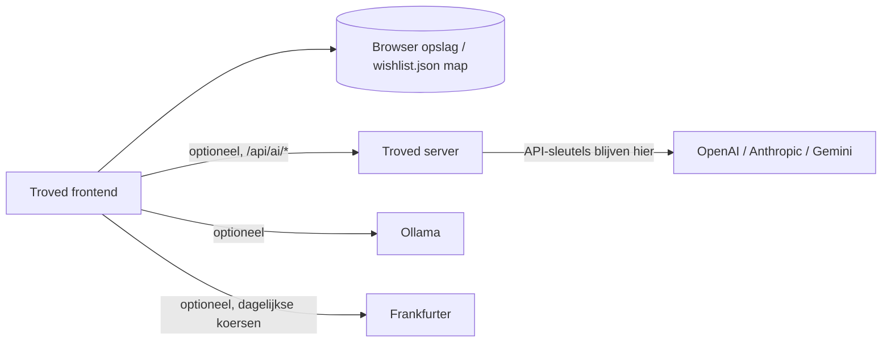

# Troved

Een persoonlijke, lokaal eerst wishlist met een rustige GitHub-geïnspireerde interface en een gedempt groene accent. Organiseer ideeën in geneste collecties, houd EUR-schattingen bij, zoek en filter je lijst, en importeer Markdown- of CSV-bestanden.

> Read this in English: [English README](README.md).

## Wat is dit?

Troved is een wishlist die in je browser draait. Je wishlist blijft in je browseropslag of in een map die je kiest; er is geen Troved-account of wishlist-database. Een optionele kleine server voegt AI-geassisteerde Markdown-import toe via OpenAI, Anthropic, Google Gemini, of een lokaal Ollama-exemplaar, maar de core-app werkt zonder hem.

## Functies

- Geneste collecties voor het organiseren van wishlist-items
- EUR-schattingen per item, met totals en optionele dagelijkse referentiekoersen van [Frankfurter](https://www.frankfurter.dev/)
- Zoek en filter in je hele lijst
- Lokaal importeren van `.md`, `.markdown`, en `.csv`-bestanden (koppen, lijstitems, Markdown-tabellen, en wishlist CSV-kolommen), met controle voordat iets wordt geïmporteerd
- Optionele AI-geassisteerde Markdown-organisatie (OpenAI, Anthropic, Google Gemini, of Ollama)
- Folder autosave naar een `wishlist.json`-bestand, JSON download/herstel, en ZIP-backup
- Licht en donker thema, toegepast vóór eerste paint zodat donker-gebruikers geen licht flits zien
- Fonts gebundeld via Fontsource (DM Sans, Manrope); er wordt geen webfont-CDN benaderd
- Toetsenbordnavigatie, dialoogfocusval, en ondersteuning voor verminderde beweging
- Tags en prioriteitsbeoordeling per item voor kruisende organisatie

## Sneltoetsen

| Sneltoets | Actie |
| --- | --- |
| `Ctrl/Cmd + K` | Focus wishlist zoekveld |
| `Ctrl/Cmd + I` | Open het toevoeg-item formulier |
| `Esc` | Sluit een dialoog (focus wordt hersteld afterwards) |

Sneltoets-hints verschijnen wanneer je hovert of focust het zoekveld en de quick-add knop.

## Techniek en architectuur

| Onderdeel | Technologie |
| --- | --- |
| Frontend | Vite (in `frontend/`) |
| Optionele server | Node.js (`server/index.mjs`) |
| Opslag | Browseropslag, optioneel een autosaved `wishlist.json` in een map die je kiest |
| Cloud AI (optioneel) | OpenAI, Anthropic, Google Gemini via de Troved server |
| Lokale AI (optioneel) | Ollama HTTP API, aangeroepen vanuit de browser |
| Wisselkoersen (optioneel) | Frankfurter referentiekoersen |
| Server tests | `npm test` in `server/` (6 slagen) |
| Deployment | Docker image / Docker Compose |



De server bedient de productie frontend build (`frontend/dist`, same origin) en blootstelt `/api/health` plus de `/api/ai/*` endpoints. Het heeft geen wishlist-database.

## AI-geassisteerde ontwikkeling

Dit project is ontwikkeld met uitgebreid gebruik van **ChatGPT en OpenAI Codex** als AI-ontwikkelhulpmiddelen.

Ik heb ChatGPT gebruikt om de projectomvang, architectuur, functies, technische keuzes en ontwikkelaanpak te bepalen. **OpenAI Codex is vervolgens als codeeragent gebruikt om de applicatie te implementeren en stapsgewijs te verbeteren.**

Mijn verantwoordelijkheden waren:

- de vereisten en gewenste functionaliteit definiëren
- architectuur- en techniekkeuzes maken
- de implementatie met iteratieve prompts aansturen
- de applicatie en integraties testen
- de gegenereerde implementatie beoordelen en corrigeren
- problemen tijdens de ontwikkeling opsporen en oplossen
- de Git/GitHub-werkwijze en projectdocumentatie opzetten

## Installatie

### Benodigdheden

- Node.js 22 of nieuwer
- Optioneel: API-sleutel(s) voor OpenAI, Anthropic, of Google Gemini voor cloud AI import-assistentie
- Optioneel: [Ollama](https://ollama.com/download) voor lokale AI import-assistentie
- Optioneel: Docker, voor de privé-implementatie hieronder beschreven

### 1. Start de frontend

Voer deze opdrachten uit vanuit de hoofdmap van de repository:

```sh
cd frontend
npm ci
npm run dev
```

Open de lokale URL die door Vite wordt afgedrukt (meestal <http://127.0.0.1:5173>). De core wishlist werkt zonder backend.

### 2. Start de optionele server

Voor cloud AI import-assistentie, open een tweede terminal vanuit de projectroot:

```sh
node server/index.mjs
```

Of voer `npm start` uit vanuit `server/`. Configureer provider-sleutels zoals beschreven onder [Configuratie](#configuratie).

### 3. Bouw voor productie

```sh
cd frontend
npm run build
```

Dit produceert `frontend/dist`, dat de server op dezelfde origin bedient. De Docker-image bouwt het automatisch.

## Optionele AI-geassisteerde import

Troved importeert `.md`, `.markdown`, en `.csv`-bestanden lokaal. De deterministische parser detecteert algemene koppen, lijstitems, Markdown-tabellen, en wishlist CSV-kolommen. Bekijk de resultaten en selecteer wat je wilt importeren.

Voor optionele AI-geassisteerde Markdown-organisatie, verbind een van de volgende:

- **OpenAI, Anthropic, of Google Gemini** via de Troved server. Hun API-sleutels worden alleen in de privé-omgeving van de server geconfigureerd.
- **Ollama** dat draait op een adres dat je browser kan bereiken. Dit is optioneel en downloadt geen modellen.

AI-assistentie verfijnt alleen Markdown-importresultaten; het is geen algemene chatfunctie. Alleen de Markdown-tekst die je expliciet kiest om te verbeteren wordt naar het geselecteerde model gestuurd, via de Troved server voor cloudproviders. Lokaal parsen gebeurt in je browser, CSV-bestanden worden niet voor AI-verwerking verstuurd, en niets wordt geïmporteerd tot je bevestigt. Lokaal gedetecteerde prijzen en links worden bewaard; bekijk altijd de modeloutput.

Cloudmodelgebruik kan kosten met zich meebrengen bij de provider. API-sleutels worden nooit in de browser ingevoerd of in dit project vastgelegd.

### Importdetails

Expliciete EUR-prijzen worden gebruikt in totals. Niet-EUR of onzekere bedragen blijven gemarkeerd als ongeverifieerd en worden uitgesloten. Prijzen die in de app worden ingevoerd, worden opgeslagen als EUR-schattingen; optionele dagelijkse referentiekoersen van Frankfurter converteren weergave-totals en itemprijzen.

## Configuratie

De server leest zijn providersleutels uit zijn privé-omgeving. Kopieer `.env.example` naar `.env` in de projectroot, houd het bestand privé, en voeg een sleutel toe alleen voor een provider die je van plan bent te gebruiken.

| Variabele | Standaard | Doel |
| --- | --- | --- |
| `PORT` | `3000` | Serverpoort |
| `HOST` | `0.0.0.0` | Server-bindadres |
| `OPENAI_API_KEY` | — | Schakelt OpenAI-modellen in voor import-assistentie |
| `ANTHROPIC_API_KEY` | — | Schakelt Anthropic-modellen in voor import-assistentie |
| `GEMINI_API_KEY` | — | Schakelt Google Gemini-modellen in voor import-assistentie |
| `TROVED_SAVE_DIR` | — | Schakelt server-side wishlist saving in. Stel een directorypad in (bijv. een gemount NAS of SMB-share) om `wishlist.json` op de server op te slaan. |

Open vervolgens in Troved **Preferences → Cloud AI models**, vernieuw modellen, kies een provider en model, en selecteer **Use for imports**.

De frontend ontvangt nooit API-sleutels. Plak nooit inloggegevens in chat of browserinstellingen.

### Thema

Het thema wordt onthouden in `wishr-theme` (of volgt het besturingssysteem wanneer niets is opgeslagen). Gebruik de zon/maan-knop in de header of **Preferences → Appearance** om te schakelen.

## Je data en backups

Troved slaat zijn werkende kopie op in browseropslag. In ondersteunde browsers zoals huidige Chrome of Edge, kan **Preferences → Choose folder** een apart `wishlist.json` autosaven waar de app op localhost of HTTPS draait en je toestemming verleent. Wanneer toestemming verloopt, verbind de map opnieuw. Op browsers of origines zonder directe mapschrijving, download JSON na bewerken en sla het zelf op.

Het kiezen van een map die al een wishlist bevat, fuseert unieke groepen en items met de huidige browserkopie; overeenkomende items worden niet gedupliceerd. Een malformed mapbestand wordt gemeld en wordt niet overschreven. Ontkoppelen laat zijn bestand ongewijzigd. Gebruik **ZIP backup** voor een draagbare momentopname, of **Restore JSON** om een geldige backup te mergen.

## Privé Proxmox-deploy

De inbegrepen Docker-setup is bedoeld voor een privé thuisnetwerk/VPN-deploy. De server heeft **geen gebruikersauthenticatie**: stel poort 3000 niet bloot aan het openbare internet, voeg geen router port-forward toe, en publiceer het niet op een onbetrouwbaar netwerk.

### 1. Maak de VM

Maak in Proxmox een Ubuntu Server 24.04 LTS VM die is gekoppeld aan je vertrouwde LAN-brug (doorgaans `vmbr0`). Voor deze lichte app, begin met 2 vCPU's, 2 GB RAM, en een 16 GB schijf. Geef de VM een DHCP-reservering in je router zodat het LAN-adres stabiel blijft. Configureer geen openbaar IP of router port-forward.

Installeer Ubuntu-updates en Docker Engine met de officiële [Docker Ubuntu-instructies](https://docs.docker.com/engine/install/ubuntu/). Houd Proxmox en Ubuntu-beheer alleen toegankelijk voor je vertrouwde LAN/VPN.

### 2. Kopieer en configureer Troved

Kopieer dit project naar de VM met een privé-methode zoals `scp` via je LAN/VPN. Vanaf de projectmap op Ubuntu:

```sh
cp .env.example .env
nano .env
```

Voeg alleen de cloudprovidersleutels toe die je gebruikt. Beperk het omgevingsbestand tot de VM-account:

```sh
chmod 600 .env
```

Bouw en start de app:

```sh
docker compose up -d --build
docker compose logs -f troved
```

De webapp en zijn same-origin AI API worden bediend op poort 3000. Bezoek `http://<VM-LAN-IP>:3000` vanaf een apparaat op je vertrouwde netwerk. Geen API-sleutel wordt aan de blootgesteld aan de browser. De server neemt contact op met een geconfigureerde provider om beschikbare modellen op te halen, en verstuurt Markdown-inhoud alleen wanneer je expliciet **Improve** kiest voor een import; providervoorwaarden en -kosten zijn van toepassing.

### 3. Beperk netwerktoegang

Stel op de VM en in de Proxmox/netwerkfirewall TCP 3000 alleen toe vanaf je daadwerkelijk vertrouwde LAN- en VPN-adresbereiken. Bijvoorbeeld, vervang deze voorbeeld-subnetten met de bereiken die door je netwerk worden gebruikt:

```sh
sudo ufw default deny incoming
sudo ufw allow from <ADMIN-LAN-CIDR> to any port 22 proto tcp
sudo ufw allow from <HOME-LAN-CIDR> to any port 3000 proto tcp
sudo ufw allow from <VPN-CIDR> to any port 3000 proto tcp
sudo ufw enable
sudo ufw status
```

Zorg ervoor dat de VPN clients routeert naar het LAN-adres van de VM. Voeg geen internet-facing port-forward of openbare reverse proxy toe: de server heeft opzettelijk geen login omdat de gekozen deploy privé-netwerk-alleen is. Voor externe toegang, verbind eerst met je VPN.

Docker publiceert containerpoorten via zijn eigen firewallregels, die UFW-regels op sommige Ubuntu-configuraties kunnen omzeilen. Verlouw je niet alleen op UFW om de gepubliceerde poort te beperken: dwing de bron-netwerkbeperking af in de Proxmox-firewall of een andere firewalllaag die Docker-gepubliceerd verkeer filtreert, en verifieer toegang vanaf zowel een toegestane als een niet-toegestane netwerk voordat je op de deploy vertrouwt.

Plain HTTP op een privé LAN wordt door deze setup gebruikt. Browsers kunnen directe folder autosave uitschakelen op een LAN HTTP-adres omdat het geen veilige browsercontext is; JSON download/herstel backups blijven beschikbaar. Als je folder autosave nodig hebt, gebruik HTTPS met een certificaat dat door je apparaten wordt vertrouwd, terwijl je de service privé houdt.

### De VM bijwerken

Na het kopiëren van bijgewerkte bronbestanden naar de VM:

```sh
docker compose up -d --build
```

Houd `.env` privé gebackupdate, nooit in broncontrole. Om de service te stoppen, voer `docker compose down` uit.

## Ontwikkelen en testen

Voer de serverendpointtests uit (6 slagen):

```sh
cd server
npm test
```

Bouw de frontend:

```sh
cd frontend
npm ci
npm run build
```

## Beveiliging en lokaal gebruik

- De server heeft geen gebruikersauthenticatie. Houd het op een privé-netwerk of achter een VPN, en stel poort 3000 nooit bloot aan het openbare internet.
- API-sleutels leven alleen in de privé-omgeving van de server (`.env`, buiten broncontrole gehouden, `chmod 600`). De browser ontvangt ze nooit.
- Je wishlist blijft in je browser of een map die je kiest. De server heeft geen wishlist-database.
- Alleen de Markdown die je expliciet kiest om te **Improve** wordt naar het geselecteerde model gestuurd. CSV-bestanden worden nooit voor AI-verwerking verstuurd, en niets wordt geïmporteerd tot je bevestigt.
- Ollama draait op een adres dat je browser kan bereiken; stel het alleen in op een endpoint dat je vertrouwt.
- Cloudmodelgebruik kan kosten met zich meebrengen en is onderhevig aan de providervoorwaarden.
- Bekijk altijd AI-output vóór importeren.

## Server-side wishlist saving (NAS / SMB)

Troved kan optioneel je wishlist opslaan in een directory op de server in plaats van (of naast) browseropslag. Dit is handig voor het behouden van een centrale kopie op een NAS of SMB-share.

1. Mount je NAS- of SMB-share op de server op een pad zoals `/mnt/nas/troved`.
2. Voeg `TROVED_SAVE_DIR=/mnt/nas/troved` toe aan het `.env`-bestand van de server.
3. Start de server opnieuw: `docker compose up -d --build`.
4. Open **Instellingen → Opslaan op server (NAS / SMB)** en klik op **Opslaan op server**.

De server schrijft `wishlist.json` naar de geconfigureerde directory. Alleen de Markdown die je expliciet kiest om te **Improve** wordt naar AI-providers gestuurd; het wishlist-bestand verlaat je server nooit.

## Toegankelijkheid

- Dialoogvensters ondersteunen Escape om te sluiten, focusherstel, en toetsenbordfocusval.
- De interface volgt de systeemvoorkeur voor verminderde beweging.
- Licht en donker thema's zijn inbegrepen.
- De browsertab toont een ingebouwd Troved-favicon (donkere tegel met een groene punt, passend bij de header-logo).

## Projectstructuur

```text
frontend/   Vite-applicatie (wishlist UI, lokale importparser, backups)
server/     Optionele Node.js-server: bedient frontend/dist, /api/health, /api/ai/*, en endpointtests
```
