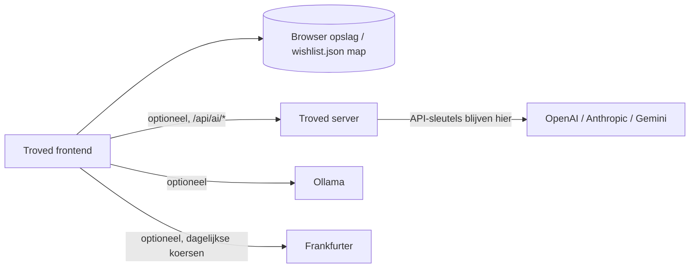

<pre>
 _________________      _____           _____     ____      ____      ______        _____
/                 \ ___|\    \     ____|\    \   |    |    |    | ___|\     \   ___|\    \
\______     ______/|    |\    \   /     /\    \  |    |    |    ||     \     \ |    |\    \
   \( /    /  )/   |    | |    | /     /  \    \ |    |    |    ||     ,_____/||    | |    |
    ' |   |   '    |    |/____/ |     |    |    ||    |    |    ||     \--'\_|/|    | |    |
      |   |        |    |\    \ |     |    |    ||    |    |    ||     /___/|  |    | |    |
     /   //        |    | |    ||\     \  /    /||\    \  /    /||     \____|\ |    | |    |
    /___//         |____| |____|| \_____\/____/ || \ ___\/___ / ||____ '     /||____|/____/|
   |`   |          |    | |    | \ |    ||    | / \ |   ||   | / |    /_____/ ||    /    | |
   |____|          |____| |____|  \|____||____|/   \|___||___|/  |____|     | /|____|____|/
     \(              \(     )/       \(    )/        \(    )/      \( |_____|/   \(    )/
      '               '     '         '    '          '    '        '    )/       '    '
                                                                         '
</pre>

> **Een persoonlijke, lokaal-eerst wishlist die volledig in je browser draait.**

[](https://opensource.org/licenses/MIT)
[](https://nodejs.org/)
[](https://www.typescriptlang.org/)
[](https://vitejs.dev/)
[]()

Organiseer ideeën in geneste collecties, houd EUR-prijzen bij, importeer Markdown- of CSV-bestanden, en plan je aankopen, allemaal zonder account, clouddatabase of internetverbinding. Je gegevens blijven op je apparaat.

> 🇬🇧 Read this in English: [English README](README.md).

---

## 📶 Inhoudsopgave

- [Wat is Troved?](#-wat-is-troved)
- [Functies](#-functies)
  - [Kern](#kern)
  - [Organisatie](#organisatie)
  - [Import & Export](#import--export)
  - [AI-assistentie](#-ai-assistentie)
  - [Plannen & Bijhouden](#-plannen--bijhouden)
  - [Interface](#-interface)
  - [Gegevens & Privacy](#-gegevens--privacy)
- [Snel starten](#-snel-starten)
- [Sneltoetsen](#-sneltoetsen)
- [Techniek & Architectuur](#-techniek--architectuur)
- [Configuratie](#-configuratie)
- [AI-geassisteerde import](#-ai-geassisteerde-import)
- [Server-side opslag (NAS / SMB)](#-server-side-opslag-nas--smb)
- [Gegevens & Back-ups](#-gegevens--back-ups)
- [Implementatie](#-implementatie)
  - [Docker / Proxmox](#docker--proxmox)
  - [Desktop-app](#-desktop-app)
- [Ontwikkeling](#-ontwikkeling)
- [Beveiliging](#-beveiliging)
- [Toegankelijkheid](#-toegankelijkheid)
- [Probleemoplossing](#-probleemoplossing)
- [Projectstructuur](#-projectstructuur)
- [AI-geassisteerde ontwikkeling](#-ai-geassisteerde-ontwikkeling)

---

## 🎯 Wat is Troved?

Troved is een **wishlist die volledig in je browser draait**. Er is geen account nodig, geen clouddatabase, en geen abonnement. Je wishlist leeft in de opslag van je browser of in een `wishlist.json`-bestand in een map die je kiest, volledig portabel, volledig van jou.

Een optionele lichte server voegt AI-geassisteerde Markdown-import toe (via OpenAI, Anthropic, Google Gemini, of lokaal Ollama), maar de kern-app werkt volledig offline zonder backend.

**Waarom Troved?**

| Traditionele wishlists | Troved |
|---|---|
| Vereisen een account | Geen account nodig |
| Bewaren gegevens op hun servers | Je gegevens blijven op je apparaat |
| Beperkte organisatie | Geneste groepen, tags, prioriteiten, statussen |
| Geen offline-toegang | Werkt 100% offline |
| Eén-op-alles | Importeer vanuit Markdown, CSV, of AI-geassisteerd |
| Geen budgettracking | Ingebouwde budget- en doelenbijhouding |

---

## ✨ Functies

### Kern

- **EUR-prijsbijhouding**: Schat prijzen per item met groep- en totaalsamenvattingen, plus optionele dagelijkse referentiekurzen van [Frankfurter](https://www.frankfurter.dev/)
- **Full-text zoekfunctie**: Zoek door itemnamen, merken, tags, links, notities en aankoopbronnen
- **Fuzzy zoekfunctie**: Vind items zelfs met typefouten; resultaten gerangschikt op matchkwaliteit
- **Sorteeropties**: Sorteer op recent toegevoegd, datum, naam (A-Z), laagste/hogste prijs, prioriteit, of status
- **Vergelijking naast elkaar**: Vergelijk geselecteerde items in een gedetailleerde tabelweergave

### Organisatie

- **Geneste collecties**: Organiseer items in groepen en subgroepen met onbeperkt nesten
- **Groep inklappen/uitklappen**: Klap geneste groepen in de zijbalk in en uit om rommel te verminderen
- **Tags**: Voeg door komma's gescheiden tags toe aan items voor kruisende organisatie
- **Tagfiltering**: Eén-klik tag-chips die itemaantallen tonen voor directe filtering
- **Prioriteitsniveaus**: Markeer items als Hoog, Midden of Laag prioriteit
- **Statusworkflow**: Houd items bij via Gewild → Onderzoek → Gepland → Aangeschaft
- **Statusfiltering**: Filter op status met dedicated sub-filters
- **Itemafhankelijkheden**: Markeer items als "geblokkeerd door" een ander item of voorwaarde
- **Sleepfunctie**: Herschik items, verplaats tussen groepen, en nest groepen via drag-and-drop (werkt op touch-apparaten)

### Import & Export

- **Markdown-import**: Importeer `.md` en `.markdown`-bestanden met koppen, lijsten en tabellen
- **CSV-import**: Importeer CSV-bestanden met wishlist-kolommen
- **AI-geassisteerde import**: Gebruik OpenAI, Anthropic, Google Gemini, of lokaal Ollama om rommelige Markdown te ordenen
- **CSV-export**: Exporteer je wishlist als CSV-bestand voor spreadsheets
- **Markdown-export**: Exporteer je wishlist als opgemaakt Markdown-bestand
- **JSON-export/herstel**: Download en herstel je wishlist als JSON
- **ZIP-backup**: Maak portable ZIP-back-ups van je volledige wishlist
- **PDF-export**: Exporteer een afdrukbare PDF met de printfunctie van de browser

### 🤖 AI-assistentie

- **Multi-provider ondersteuning**: Kies uit OpenAI, Anthropic, Google Gemini, of lokaal Ollama
- **Markdown-organisatie**: AI verfijnt rommelige Markdown tot gestructureerde wishlist-items
- **Privacy-geëerst**: Alleen de Markdown die je kiest om te verbeteren wordt verzonden; CSV-bestanden worden nooit verzonden
- **Lokale AI**: Gebruik Ollama voor volledig privé, offline AI-verwerking

### 📊 Plannen & Bijhouden

- **Budgettracking**: Stel een maandbudget in en monitor uitgaven met een visuele voortgangsbalk
- **Wishlistdoelen**: Stel een doel aantal items in om te kopen met een optionele deadline
- **Prijsalerts**: Stel een doelprijs in per item; krijg een "🔔 Deal!"-badge wanneer de prijs daalt
- **Prijs historie**: Houd prijsveranderingen bij over tijd met sparkline-grafieken op itemkaarten
- **Prijs tijdlijnweergave**: Klik op een sparkline voor een gedetailleerde prijsgrafiek met statistieken
- **Aankoophistorie**: Registreer wanneer en waar je elk item kocht
- **Item notitiesjournal**: Voeg gedateerde notities toe aan items over tijd voor onderzoek en beslissingen
- **Statistieken dashboard**: Bekijk SVG-grafieken met uitgaven per groep en items per status

### 🎨 Interface

- **Licht & donker thema**: Toegepast vóór eerste paint; geen flits voor donker-gebruikers
- **Donkere modus-schema**: Schakel automatisch thema's op basis van tijd van dag of systeemvoorkeur
- **Itemafbeeldingen**: Voeg productafbeeldings-URL's toe weergegeven als miniaturen op itemkaarten
- **Winkelwagenmodus**: Compacte controlelijstweergave van gekochte items, geoptimaliseerd voor gebruik in de winkel
- **Wishlist delen**: Genereer een deelbare link of download JSON voor cadeaugidsen
- **PWA-ondersteuning**: Installeer als standalone-app met offline-toegang
- **Toetsenbordnavigatie**: Volledige toetsenbordondersteuning met focusval in dialogen
- **Gebundelde lettertypen**: DM Sans en Manrope via Fontsource; geen externe CDN-aanroepen
- **Bulkacties**: Selecteer meerdere items om status te wijzigen, te verplaatsen, of te verwijderen
- **Itemduplicatie**: Dupliceer elk item met één klik vanuit het itemmenu
- **Itemfavorieten**: Markeer items met een ster voor snelle toegang met een dedicated favorietenfilter
- **Groep kleurcodering**: Wijs kleuren toe aan groepen voor visuele onderscheiding in de zijbalk

### 🔒 Gegevens & Privacy

- **Lokaal-eerst**: Je gegevens verlaten je apparaat nooit tenzij je dat kiest
- **Map autosave**: Automatisch opslaan naar `wishlist.json` in een map die je kiest
- **Geen account nodig**: Geen registratie, geen clouddatabase, geen tracking
- **Server-side opslag**: Optionele NAS/SMB-opslag voor centrale back-up
- **Verminderde beweging ondersteuning**: Eerbiedigt systeemtoegankelijkheidsvoorkeuren

---

## 🚀 Snel starten

Krijg Troved draaiend in minder dan een minuut:

```sh
# Kloon en installeer
git clone https://github.com/LukaG712/Troved.git
cd Troved/frontend
npm ci
npm run dev
```

Open de lokale URL die door Vite wordt afgedrukt (meestal `http://127.0.0.1:5173`). Klaar, Troved werkt zonder backend.

**Wil je AI-geassisteerde import?** Start de optionele server in een tweede terminal:

```sh
node server/index.mjs
```

**Wil je een desktop-app?** Zie de [Desktop-app](#-desktop-app) sectie hieronder.

**Wil je implementeren op je thuisnetwerk?** Zie de [Docker / Proxmox](#docker--proxmox) sectie.

---

## ⌨️ Sneltoetsen

| Sneltoets | Actie |
| --- | --- |
| `Ctrl/Cmd + K` | Focus het zoekveld |
| `Ctrl/Cmd + I` | Open het toevoeg-item formulier |
| `Esc` | Sluit een dialoog (focus wordt hersteld) |

> 💡 Sneltoets-hints verschijnen wanneer je hovert of focust het zoekveld en de quick-add knop.

---

## 🏗️ Techniek & Architectuur

| Onderdeel | Technologie |
| --- | --- |
| Frontend | Vite (in `frontend/`) |
| Optionele server | Node.js (`server/index.mjs`) |
| Opslag | Browseropslag, optioneel een autosaved `wishlist.json` in een map die je kiest |
| Cloud AI (optioneel) | OpenAI, Anthropic, Google Gemini via de Troved server |
| Lokale AI (optioneel) | Ollama HTTP API, aangeroepen vanuit de browser |
| Wisselkoersen (optioneel) | Frankfurter referentiekurzen |
| Server tests | `npm test` in `server/` (6 slagen) |
| Frontend tests | `npm test` in `frontend/` (27 slagen) |
| Implementatie | Docker image / Docker Compose |



De server bedient de productie frontend build (`frontend/dist`, same origin) en blootstelt `/api/health` plus de `/api/ai/*` endpoints. Het heeft geen wishlist-database.

---

## 📦 Installatie

### Benodigdheden

- **Vereist:** Node.js 22 of nieuwer
- **Optioneel:** API-sleutel(s) voor OpenAI, Anthropic, of Google Gemini (voor cloud AI import)
- **Optioneel:** [Ollama](https://ollama.com/download) (voor lokale AI import)
- **Optioneel:** Docker (voor privé-implementatie)

### Stap 1: Start de frontend

```sh
cd frontend
npm ci
npm run dev
```

Open de lokale URL die door Vite wordt afgedrukt (meestal `http://127.0.0.1:5173`). De core wishlist werkt zonder backend.

### Stap 2: Start de optionele server (AI import)

Voor cloud AI import-assistentie, open een tweede terminal:

```sh
node server/index.mjs
```

Of voer `npm start` uit vanuit `server/`. Configureer provider-sleutels zoals beschreven onder [Configuratie](#-configuratie).

### Stap 3: Bouw voor productie

```sh
cd frontend
npm run build
```

Dit produceert `frontend/dist`, dat de server op dezelfde origin bedient. De Docker-image bouwt het automatisch.

---

## 🤖 AI-geassisteerde import

Troved importeert `.md`, `.markdown`, en `.csv`-bestanden lokaal. De deterministische parser detecteert koppen, lijstitems, Markdown-tabellen, en wishlist CSV-kolommen. Bekijk de resultaten en selecteer wat je wilt importeren.

### Hoe AI-assistentie werkt

Voor optionele AI-geassisteerde Markdown-organisatie, verbind een van:

| Provider | Hoe het verbindt | Privacy |
|---|---|---|
| **OpenAI** | Via de Troved server | API-sleutel blijft op server |
| **Anthropic** | Via de Troved server | API-sleutel blijft op server |
| **Google Gemini** | Via de Troved server | API-sleutel blijft op server |
| **Ollama (lokaal)** | Direct vanuit je browser | Volledig offline, geen API-sleutel |

> 🔒 **Privacy-first:** AI-assistentie verfijnt alleen Markdown-importresultaten. Alleen de Markdown die je expliciet kiest om te **Verbeteren** wordt verzonden. CSV-bestanden worden nooit voor AI-verwerking verstuurd, en niets wordt geïmporteerd tot je bevestigt.

### Importdetails

- Expliciete EUR-prijzen worden gebruikt in totals
- Niet-EUR of onzekere bedragen blijven gemarkeerd als ongeverifieerd en worden uitgesloten
- Prijzen die in de app worden ingevoerd, worden opgeslagen als EUR-schattingen
- Optionele dagelijkse referentiekurzen van [Frankfurter](https://www.frankfurter.dev/) converteren weergave-totals en itemprijzen

---

## ⚙️ Configuratie

De server leest zijn providersleutels uit zijn privé-omgeving. Kopieer `.env.example` naar `.env` in de projectroot, houd het bestand privé, en voeg een sleutel toe alleen voor een provider die je van plan bent te gebruiken:

```sh
cp .env.example .env
nano .env  # Voeg je API-sleutels toe
chmod 600 .env  # Beperk toegang
```

### Omgevingsvariabelen

| Variabele | Standaard | Doel |
| --- | --- | --- |
| `PORT` | `3000` | Serverpoort |
| `HOST` | `0.0.0.0` | Server-bindadres |
| `OPENAI_API_KEY` | Geen | Schakelt OpenAI-modellen in voor import-assistentie |
| `ANTHROPIC_API_KEY` | Geen | Schakelt Anthropic-modellen in voor import-assistentie |
| `GEMINI_API_KEY` | Geen | Schakelt Google Gemini-modellen in voor import-assistentie |
| `TROVED_SAVE_DIR` | Geen | Server-side wishlist opslagdirectory (bijv. gemount NAS/SMB) |

### AI instellen in de app

Na configuratie van `.env`, open in Troved **Voorkeuren → Cloud AI-modellen**, vernieuw modellen, kies een provider en model, en selecteer **Gebruiken voor imports**.

> ⚠️ **Beveiliging:** De frontend ontvangt nooit API-sleutels. Plak nooit inloggegevens in chat of browserinstellingen.

### Thema

Het thema wordt onthouden in `wishr-theme` (of volgt het besturingssysteem wanneer niets is opgeslagen). Gebruik de zon/maan-knop in de header of **Voorkeuren → Uiterlijk** om te schakelen.

---

## 💾 Server-side opslag (NAS / SMB)

Troved kan optioneel je wishlist opslaan in een directory op de server in plaats van (of naast) browseropslag. Dit is handig voor het behouden van een centrale kopie op een NAS of SMB-share.

### Instellen

1. Mount je NAS- of SMB-share op de server op een pad zoals `/mnt/nas/troved`
2. Voeg `TROVED_SAVE_DIR=/mnt/nas/troved` toe aan het `.env`-bestand van de server
3. Start de server opnieuw: `docker compose up -d --build`
4. Open **Instellingen → Opslaan op server (NAS / SMB)** en klik op **Opslaan op server**

De server schrijft `wishlist.json` naar de geconfigureerde directory. Het wishlist-bestand verlaat je server nooit.

---

## 📁 Gegevens & Back-ups

Troved slaat zijn werkende kopie op in browseropslag. Hier is hoe je je gegevens veilig houdt:

### Map autosave

In ondersteunde browsers (Chrome, Edge), gebruik **Voorkeuren → Map kiezen** om een `wishlist.json`-bestand automatisch op te slaan. Vereist localhost of HTTPS met je toestemming. Als toestemming verloopt, verbind de map opnieuw.

### Handmatige back-up

Op browsers zonder directe mapschrijving, download JSON na bewerken en sla het zelf op.

### Back-up opties

| Methode | Gebruiksdoel |
|---|---|
| **Map autosave** | Automatische back-up naar een lokale map |
| **JSON-download** | Handmatige back-up na bewerken |
| **ZIP-backup** | Portable momentopname van je volledige wishlist |
| **JSON herstellen** | Een geldige back-up samenvoegen met je huidige lijst |
| **Server-opslag** | Centrale back-up op NAS/SMB |

> 💡 Het kiezen van een map die al een wishlist bevat, voegt unieke groepen en items samen, overeenkomende items worden nooit gedupliceerd. Een beschadigd bestand wordt gemeld en nooit overschreven.

---

## 🚀 Implementatie

### Docker / Proxmox

De inbegrepen Docker-setup is bedoeld voor een **privé thuisnetwerk/VPN-implementatie**. De server heeft **geen gebruikersauthenticatie**, stel poort 3000 niet bloot aan het openbare internet.

> ⚠️ **Beveiligingswaarschuwing:** Voeg nooit een router port-forward toe of publiceer Troved op een onbetrouwbaar netwerk.

#### Stap 1: Maak de VM

Maak in Proxmox een Ubuntu Server 24.04 LTS VM die is gekoppeld aan je vertrouwde LAN-brug (doorgaans `vmbr0`):

| Resource | Aanbevolen |
|---|---|
| vCPUs | 2 |
| RAM | 2 GB |
| Schijf | 16 GB |

Geef de VM een DHCP-reservering in je router zodat het LAN-adres stabiel blijft. Installeer Docker Engine volgens de officiële [Docker Ubuntu-instructies](https://docs.docker.com/engine/install/ubuntu/).

#### Stap 2: Kopieer en configureer Troved

```sh
# Kopieer project naar VM via scp, dan:
cp .env.example .env
nano .env  # Voeg alleen de API-sleutels toe die je gebruikt
chmod 600 .env  # Beperk toegang
```

Bouw en start:

```sh
docker compose up -d --build
docker compose logs -f troved
```

Bezoek `http://<VM-LAN-IP>:3000` vanaf een apparaat op je vertrouwde netwerk.

#### Stap 3: Beperk netwerktoegang

```sh
sudo ufw default deny incoming
sudo ufw allow from <HOME-LAN-CIDR> to any port 3000 proto tcp
sudo ufw allow from <VPN-CIDR> to any port 3000 proto tcp
sudo ufw enable
```

> 🔒 **Belangrijk:** Docker kan UFW-regels omzeilen. Dwong bron-netwerkbeperkingen af in de Proxmox-firewall of een andere firewalllaag, en verifieer toegang vanaf zowel toegestane als niet-toegestane netwerken.

#### Bijwerken

```sh
docker compose up -d --build
```

Houd `.env` privé gebackupt. Om te stoppen: `docker compose down`.

---

### 🖥️ Desktop-app

Een standalone Windows desktop-app is beschikbaar, geen browsertabbladen, geen installatie vereist.

| Bestand | Beschrijving |
|---|---|
| `Desktop/release/Troved-Portable.exe` | Enkel portable executable, dubbelklik en run |

De desktop-app bundelt de frontend en Node.js server samen, en opent Troved in zijn eigen native venster. Je gegevens blijven in browseropslag of een map die je kiest, net als de webversie.

#### De desktop-app bouwen

```sh
# Bouw eerst de frontend
cd frontend && npm ci && npm run build

# Bouw de portable desktop-app
cd ../Desktop && npm ci && npm run build
```

Het portable executable staat op `Desktop/release/Troved-Portable.exe`.

---

## 🛠️ Ontwikkeling

### Tests uitvoeren

```sh
# Frontend tests (27 slagen)
cd frontend && npm test

# Server tests (6 slagen)
cd server && npm test
```

**Totaal: 33 slagen**

### Bouwen

```sh
cd frontend
npm ci
npm run build
```

### Projectstructuur

```text
Troved/
├── frontend/       Vite-applicatie (wishlist UI, importparser, back-ups)
│   ├── src/        TypeScript/React bronbestanden
│   ├── index.html  Entry point
│   └── package.json
├── server/         Optionele Node.js-server
│   ├── index.mjs   Server entry point
│   └── index.test.mjs  Server tests
├── Desktop/        Electron wrapper voor portable .exe
├── Dockerfile      Docker image definitie
├── docker-compose.yml  Docker Compose configuratie
├── manifest.json   PWA manifest
├── sw.js           Service worker voor offline ondersteuning
├── README.md       Dit bestand
└── README.nl.md    Nederlandse vertaling
```

---

## 🔒 Beveiliging

- **Geen authenticatie**: De server heeft geen gebruikerslogin. Houd het op een privé-netwerk of achter een VPN.
- **Nooit poort 3000 blootstellen** aan het openbare internet.
- **API-sleutels** leven alleen in de `.env`-bestand van de server (buiten broncontrole gehouden, `chmod 600`). De browser ontvangt ze nooit.
- **Je gegevens blijven lokaal**: Je wishlist leeft in je browser of een map die je kiest. De server heeft geen wishlist-database.
- **AI-privacy**: Alleen de Markdown die je expliciet kiest om te **Verbeteren** wordt naar het geselecteerde model gestuurd. CSV-bestanden worden nooit verzonden.
- **Ollama**: Stel alleen in op een endpoint dat je vertrouwt.
- **Cloud-kosten**: Cloudmodelgebruik kan kosten met zich meebrengen bij de provider.
- **Altijd controleren** AI-output vóór importeren.

---

## ♿ Toegankelijkheid

- **Toetsenbordnavigatie**: Volledige toetsenbordondersteuning met zichtbare focus-indicatoren
- **Dialoogfocusval**: Focus blijft binnen geopende dialogen
- **Escape om te sluiten**: Druk `Esc` om een willekeurige dialoog te sluiten (focus wordt hersteld)
- **Verminderde beweging**: Eerbiedigt de systeemvoorkeur `prefers-reduced-motion`
- **Licht & donker thema's**: Twee complete thema's met goede contrastverhoudingen
- **Aangepast favicon**: Ingebouwd Troved-favicon (donkere tegel met een groene punt)

---

## 🐛 Probleemoplossing

### Map autosave werkt niet

- **Oorzaak:** Map autosave vereist een veilige context (localhost of HTTPS). Plain HTTP op een LAN-adres werkt mogelijk niet.
- **Oplossing:** Gebruik JSON-download/herstel voor back-ups, of stel HTTPS in met een vertrouwd certificaat.

### AI-import werkt niet

- **Oorzaak:** Ontbrekende of ongeldige API-sleutel in `.env`.
- **Oplossing:** Verifieer dat je API-sleutel correct is en de server draait. Controleer `docker compose logs troved` op fouten.

### Docker-poort conflicten

- **Oorzaak:** Poort 3000 is al in gebruik.
- **Oplossing:** Wijzig de poort in `.env`: `PORT=3001`, en herbouw met `docker compose up -d --build`.

### Wishlist wordt niet opgeslagen

- **Oorzaak:** Browseropslag is vol of map-toestemming is verlopen.
- **Oplossing:** Gebruik **Instellingen → Map kiezen** om opnieuw te verbinden, of download een JSON-back-up.

### Donkere modus flits bij laden

- **Oorzaak:** Thema wordt toegepast vóór eerste paint, maar sommige browsers flitsen nog steeds.
- **Oplossing:** Dit is een browserbeperking. Het thema wordt zo vroeg mogelijk ingesteld om de flits te minimaliseren.

---

## 🤖 AI-geassisteerde ontwikkeling

Dit project is ontwikkeld met uitgebreid gebruik van **AI-ontwikkelhulpmiddelen** waaronder ChatGPT en OpenAI Codex.

De menselijke ontwikkelaar was verantwoordelijk voor:

- Het definiëren van vereisten en gewenste functionaliteit
- Het maken van architectuur- en techniekkeuzes
- Het aansturen van implementatie via iteratieve prompts
- Het testen van de applicatie en integraties
- Het beoordelen en corrigeren van gegenereerde code
- Het opsporen en oplossen van problemen tijdens ontwikkeling
- Het opzetten van de Git/GitHub-werkwijze en documentatie